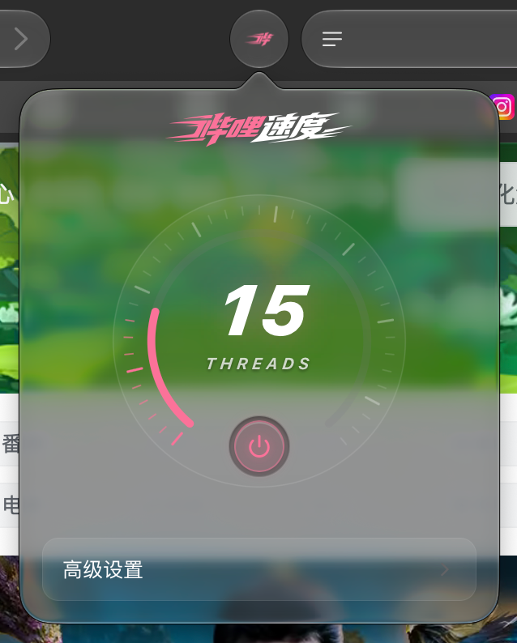
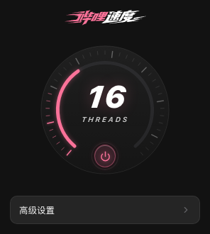
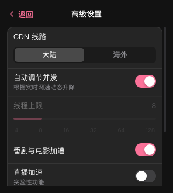
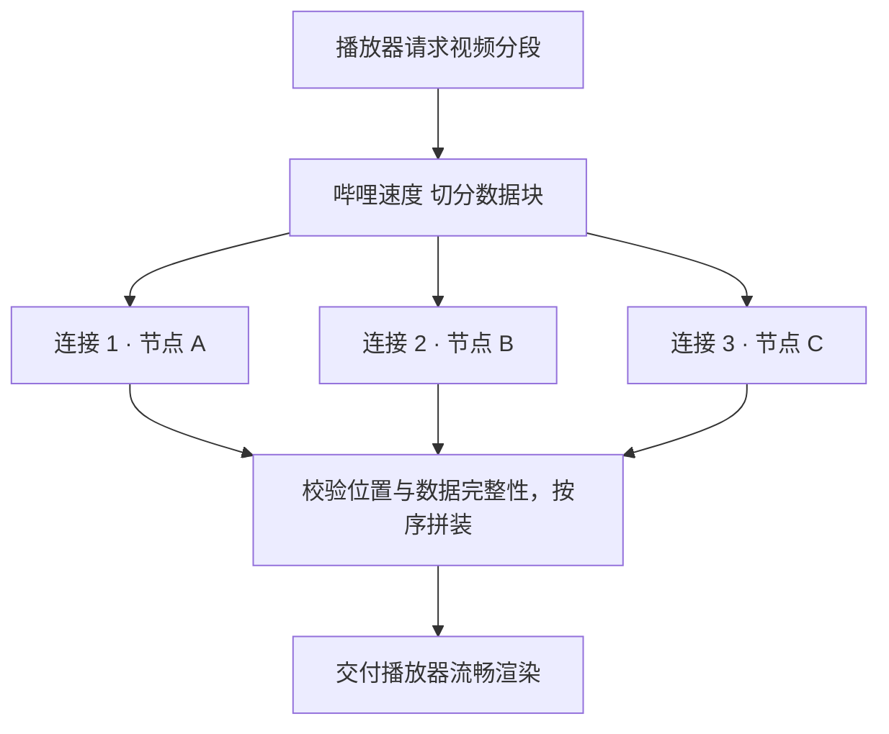

# 哔哩速度 (Bilibili Speed)

**针对海外 B 站卡顿与高码率加载优化的流媒体加速器 · macOS Safari 原生扩展**

 

<table>
  <tr>
    <td align="center" width="50%">
      <b>macOS Safari 弹出窗口实测</b>  
      
       系统原生毛玻璃与拟物表盘
    </td>
    <td align="center" width="50%">
      <b>暗黑 / 浅色双模式界面</b>  
      
      
       精细化并发指示与高级设置
    </td>
  </tr>
</table>

> [!NOTE]
> **非官方项目与致谢声明**：
> 本项目为**非官方**开源项目，由 [@Aintor](https://github.com/Aintor) 基于 [@MrTangLuyao](https://github.com/MrTangLuyao) 的开源项目 [Bilibili-thread-ripper（B 站线程撕裂者）](https://github.com/MrTangLuyao/Bilibili-thread-ripper) 进行 macOS 原生 App 封装与 Safari 扩展界面重构。
> * 如果你使用的是 **Chrome、Edge 或 Firefox**，或者希望通过油猴脚本运行，请前往 [原作者官方仓库](https://github.com/MrTangLuyao/Bilibili-thread-ripper) 获取油猴脚本版。
> * 本项目仅针对客户端公开合法的视频分片进行多线程缓冲调度，绝不绕过大会员、登录状态、区域限制、清晰度限制、数字版权管理（DRM）或媒体签名限制。

---

## 特性亮点

- **macOS 原生体验**：封装为独立的 macOS 应用程序（`哔哩速度.app`），一键随 Safari 启用，无需安装任何油猴脚本管理器。
- **触控拟物表盘**：重构的高质感数码仪表盘，实时呈现当前播放标签页的**真实并发连接数**与运行状态（空闲或未播放时精准归零）。
- **系统深浅色自适应**：完美适配 macOS 暗黑模式与浅色模式，采用纯原生 CSS/SVG 渲染，无第三方大体积框架依赖。
- **核心分片调度**：继承多线程 Range 切片与智能 CDN 调度内核，解决海外单连接慢、4K/8K 与冷门视频频繁缓冲卡顿的问题。

---

## 下载与安装 (macOS Safari)

1. 前往 **[Releases 页面](https://github.com/Aintor/Bilibili-thread-ripper/releases/latest)** 下载最新版本的 `Bilibili-Speed-v1.0.1.dmg`（或 `.zip`）；
2. 打开 DMG，将 **哔哩速度** 拖入 **Applications（应用程序）** 文件夹；
3. **首次运行（绕过 Gatekeeper）**：
   - 双击运行一次应用程序文件夹中的「哔哩速度」；
   - 若系统提示“无法验证开发者”，请前往 macOS **「系统设置」** -> **「隐私与安全性」**，滑到下方点击 **「仍要打开」**（或在访达中右键点击 App 选择「打开」）；
4. **在 Safari 中启用扩展**：
   - 打开 **Safari 浏览器**；
   - 菜单栏 **设置** -> **高级** -> 勾选 **「为开发者显示功能」**；
   - 菜单栏 **开发** -> 勾选 **「允许未签名的扩展」**；
   - 菜单栏 **设置** -> **扩展** -> 勾选启用 **「哔哩速度」**；
   - **关键权限设置**：在扩展设置中，将 `bilibili.com` 与 `hdslb.com` 均设为 **「总是允许」**，确保扩展能正常接管视频流缓冲。

---

## 工作原理

海外宽带看 B 站冷门或高码率视频时，官方播放器默认只建立**单条连接**串行拉取数据，受跨国延迟影响极易卡顿转圈。

「哔哩速度」将视频流切分为多个微小块（Range Blocks），分派给多条连接并发下载并校验完整性，再按序递交给原生播放器：

---

## 原项目入口与开源协议

- **原作者核心项目**：[MrTangLuyao/Bilibili-thread-ripper](https://github.com/MrTangLuyao/Bilibili-thread-ripper)（油猴脚本、通用 Web 扩展及底层调度内核）
- **开源许可证**：本项目遵循 [MIT License](LICENSE)，完整保留原作者版权与许可声明。
